# AzubiPrep

**Progressive Web App zur IHK-Prüfungsvorbereitung für Fachinformatiker**
(FIAE, FISI, DPA, DVK) – Lernmodule, Karteikarten mit Spaced Repetition,
Prüfungssimulation und Fortschritts-Tracking, wahlweise als Web-App oder
installierbare Windows-Desktop-App. Dazu kommen eine HTML-/CSS-/JavaScript-Werkstatt,
Theorie & Glossar und freiwillige Lernhilfe mit lokalem Qwen oder eigenem ChatGPT-Abo.


---

## Inhaltsverzeichnis

- [Über das Projekt](#über-das-projekt)
- [Screenshots](#screenshots)
- [Funktionsumfang](#funktionsumfang)
- [Lokale Lernbegleitung und eigene Unterlagen](#lokale-lernbegleitung-und-eigene-unterlagen)
- [Tech-Stack](#tech-stack)
- [Schnellstart (Web-App)](#schnellstart-web-app)
- [Desktop-App (Electron)](#desktop-app-electron)
- [Inhalte pflegen (ohne Code)](#inhalte-pflegen-ohne-code)
- [Projektstruktur](#projektstruktur)
- [Dokumentation](#dokumentation)
- [Projektstand & Roadmap](#projektstand--roadmap)

## Über das Projekt

AzubiPrep unterstützt Auszubildende der vier Fachinformatiker-Fachrichtungen
bei der Vorbereitung auf die IHK-Abschlussprüfung: **7.000 Prüfungsfragen** in
**26 Modulen**, aufbereitet als interaktives Quiz, Karteikarten-Training und
zeitlimitierte Prüfungssimulation mit automatischer Auswertung. Lernfelder
gliedern den Einstieg. Theorie & Glossar helfen beim Verstehen vor dem Quiz;
die Frontend-Werkstatt bietet **82 praktisch eingebundene Lektionen in Kapitel
1–17** und **85 zusätzliche Inhaltslektionen für Kapitel 18–31**.

**Quellstand und fertige Pakete:** Desktop **0.1.4** enthält 7.000 Fragen,
Theorie & Glossar, die freiwillige KI-Auswahl, lokale PDF-Wissenssuche und den
aktuellen Werkstattstand. Die älteren Webpakete **0.1.2** enthalten diese späteren
Erweiterungen noch nicht. Modelle, eigene Unterlagen und angemeldete Konten
werden nicht mitgeliefert. Die Screenshots zeigen ausgewählte App-Ansichten.

Bewusste Architektur-Entscheidung für den MVP: **kein erzwungener
Datenbank-Server, kein Pflicht-Login, kein Docker.** Das Backend ist im
Kern ein zustandsloser Content-Server, der Fragen und Theorie aus
Excel/CSV- bzw. Markdown-Dateien lädt – Lernfortschritt liegt standardmäßig
clientseitig in `localStorage` und die App funktioniert ohne Konto
vollständig. Wer möchte, kann optional ein Konto anlegen (PostgreSQL,
siehe [`docs/19-Datenbank-Login.md`](docs/19-Datenbank-Login.md)) und den
Lernstand darüber manuell zwischen mehreren Geräten hoch-/herunterladen –
über dieselbe Repository-Schicht im Frontend (`frontend/src/api`), ohne
dass der lokale Modus dafür umgebaut wurde. Auch die Fragen/Module selbst
können optional in derselben PostgreSQL-Datenbank liegen statt nur in
CSV (`DATABASE_URL` gesetzt und Tabellen befüllt) – CSV bleibt dabei
automatisch erzeugter Fallback und git-versionierter Review-Snapshot,
die App läuft in jedem Fall auch komplett ohne Datenbank weiter (siehe
[`docs/10-Architektur.md`](docs/10-Architektur.md), Abschnitt
"Content-Datenbank").

Entwickelt wird AzubiPrep im Agentic-Coding-Ansatz: Ich plane die
Architektur, gebe Aufgaben an KI-Agenten aus und reviewe deren Umsetzung –
als Projektverantwortlicher trage ich dabei die technische
Gesamtverantwortung für Qualität und Architektur (Workflow:
[`ORCHESTRATOR.md`](ORCHESTRATOR.md), Konventionen: [`AGENTS.md`](AGENTS.md)).

## Screenshots

Aktuelle Aufnahmen vom 31.10.2026 aus einem getrennten Demoprofil mit
öffentlichen App-Inhalten und selbst erstellten Beispieldaten. Keine privaten
Unterlagen, persönlichen Lerndaten oder Modellantworten sind abgebildet.

| | |
|---|---|
| 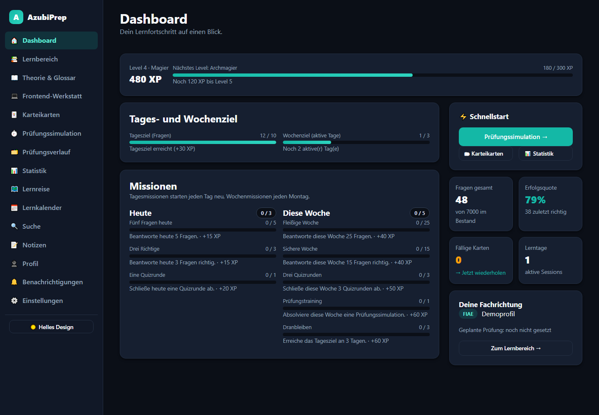 | 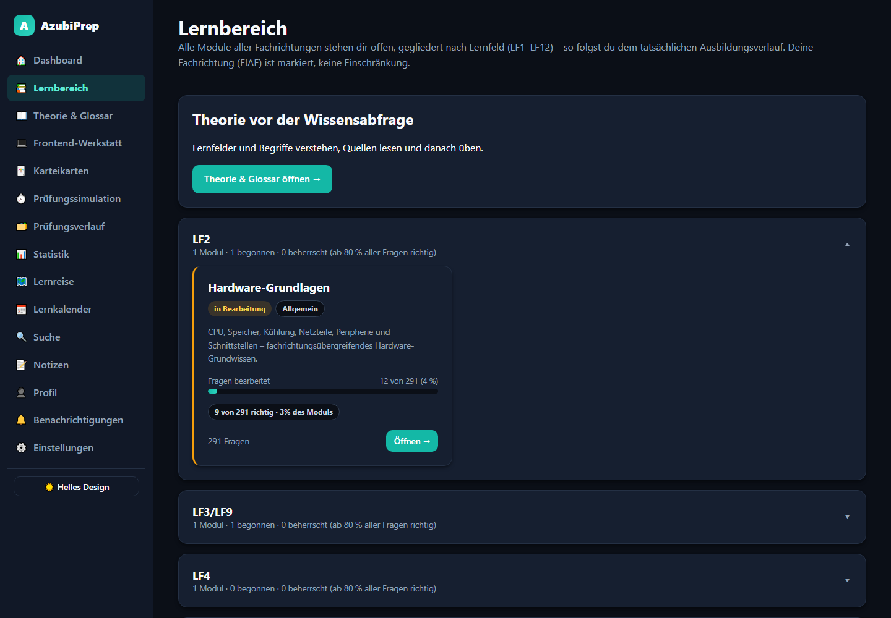 |
| **Dashboard** – XP, Tages-/Wochenziel, Missionen | **Lernbereich** – Module nach Lernfeld und Fachrichtung |
| 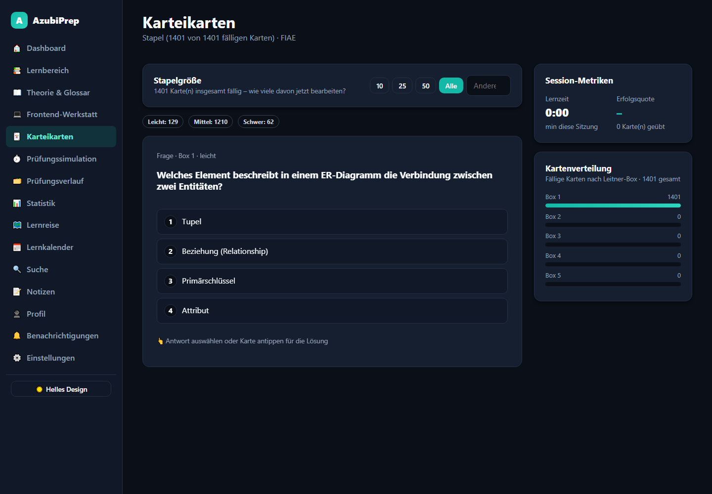 | 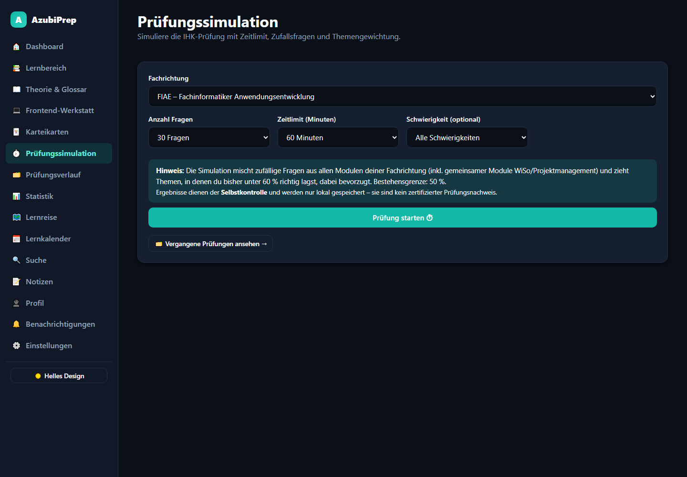 |
| **Karteikarten** – Leitner-System, Ziffern statt Buchstaben | **Prüfungssimulation** – Zeitlimit & Themengewichtung |
| 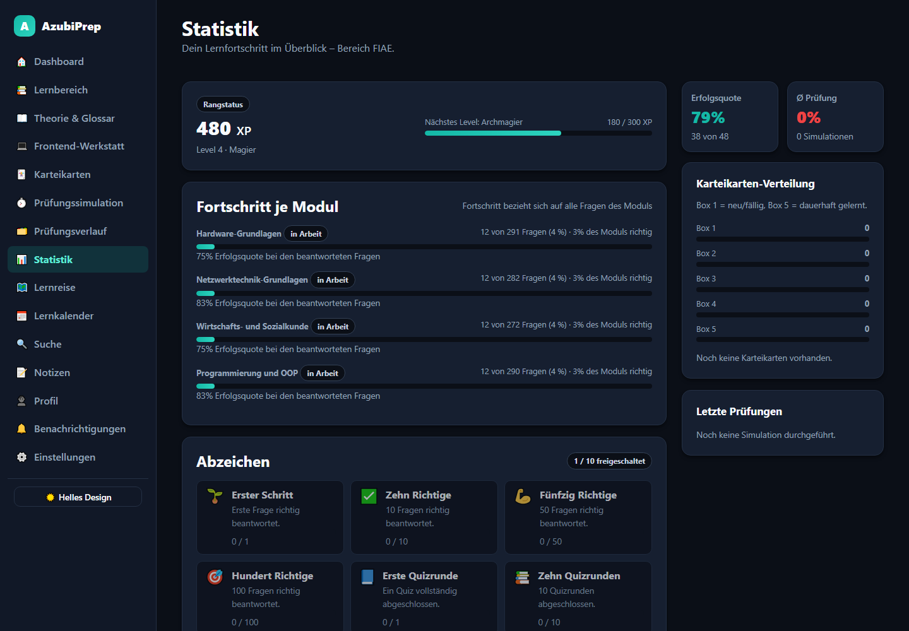 | 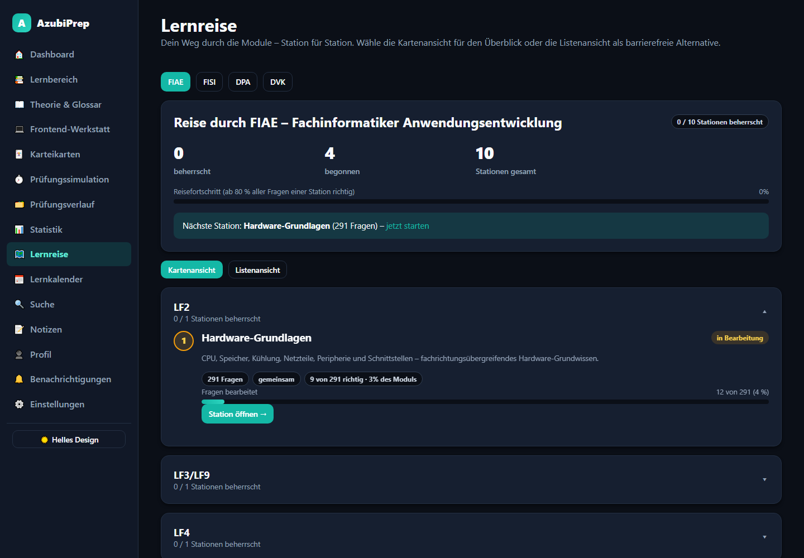 |
| **Statistik & Abzeichen** – Fortschritt & Gamification | **Lernreise** – Stationenweg durch die Module |
| 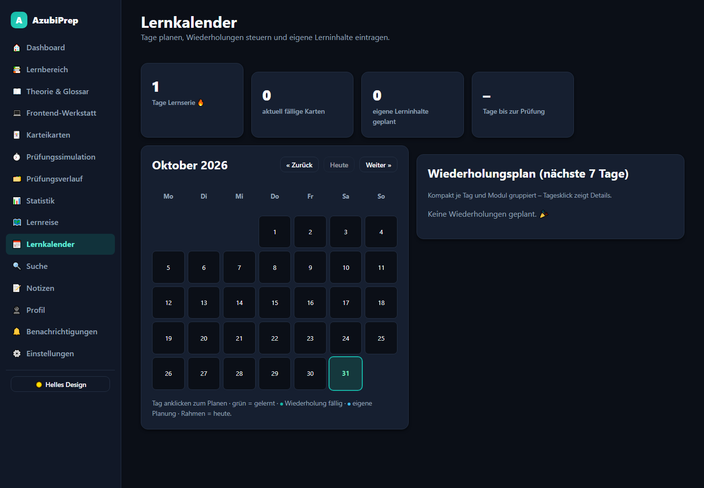 | 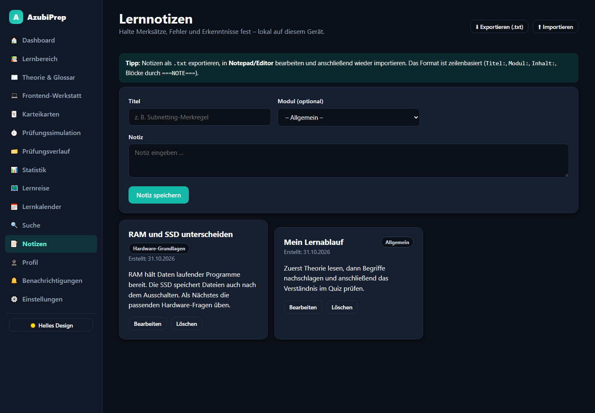 |
| **Lernkalender** – Wiederholungsplan & eigene Lerninhalte | **Lernnotizen** – lokal, export-/importierbar als `.txt` |
| 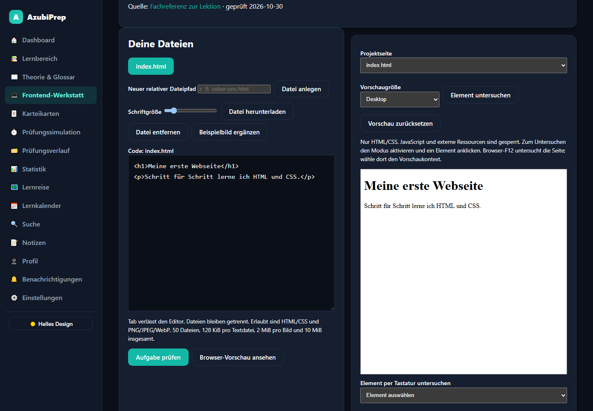 | 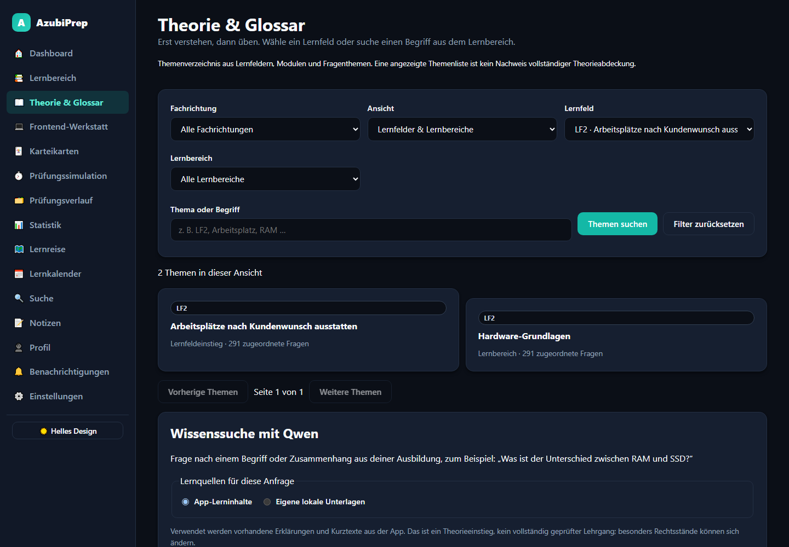 |
| **Frontend-Werkstatt** – eigener HTML-Code und isolierte Vorschau | **Theorie & Glossar** – Lernfeldeinstiege und Begriffssuche |
| 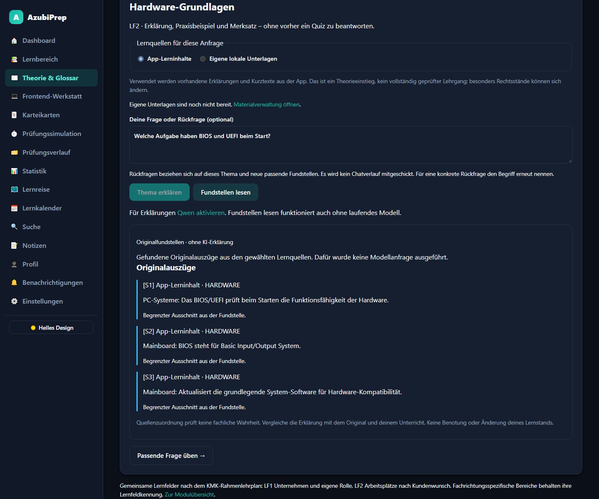 | 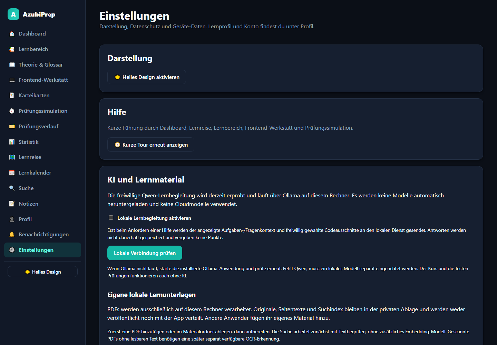 |
| **Fundstellen lesen** – öffentliche Originalauszüge ohne Modellanfrage | **Einstellungen** – Darstellung und optionale lokale Lernbegleitung |

**Mobile Ansichten** im hellen Design:

| | |
|---|---|
| 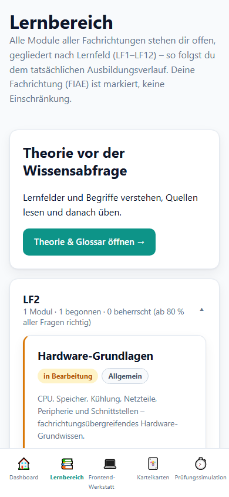 | 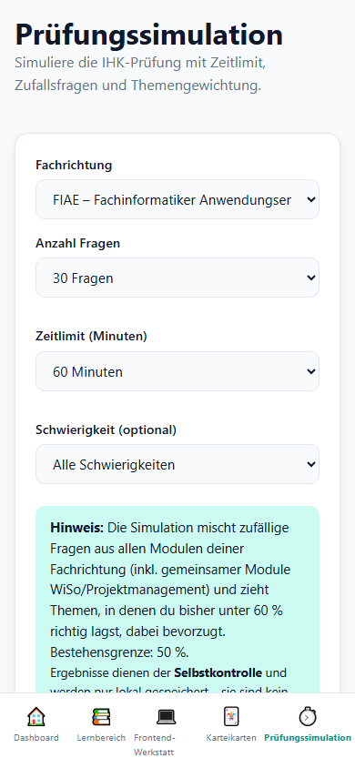 |
| **Lernbereich** (mobil, helles Design) | **Prüfungssimulation** (mobil, helles Design) |

## Funktionsumfang

**Lernen & Üben**

- 7.000 Fragen in 26 Modulen, nach Lernfeld und Fachrichtung gegliedert
- Theorie & Glossar mit Lernfeldeinstiegen, Fragenthemen und passenden Übungsfragen
- Optionale Qwen-Erklärungen mit Praxisbeispiel und Merksatz; Originalfundstellen separat lesen
- Ausführliche Lernfelder mit geordneten Teilthemen, einzelnen Erklärungen oder einem abbrechbaren Ablauf durch alle offenen Abschnitte
- Frontend-Werkstatt mit 82 Übungen in Kapitel 1–17: HTML, CSS, Formulare und JavaScript-Grundlagen bis zu Funktionen, Arrays, Schleifen und Objekten
- Editor, Mehrdateiprojekte, externe Dateiauswahl, skriptfreie HTML-/CSS-Vorschau mit Inspektor und feste Aufgabenprüfungen
- JavaScript bewusst in einer begrenzten lokalen Konsole ausführen; keine DOM-, Datei-, Netzwerk- oder App-Brücken für eigene Programme
- Weitere 85 Lektionen in Kapitel 18–31 unter „Kapitel 18–31 lesen“: Erklärungen, Übungen, gestufte Hilfen, Lösungen und Projekte bis TypeScript, React und Abschlussportal; technische Einbindung und praktische Abnahme dieser neuen Kapitel noch offen
- Quizmodus mit Sofort-Feedback und Erklärung (Single-Choice, Multiple-Choice, Freitext)
- Karteikartenmodus mit Spaced Repetition (Leitner-System, 5 Boxen)
- Prüfungssimulation mit Zeitlimit, Zufallsfragen, Themengewichtung und Bestehensgrenze
- Volltextsuche über Fragen, Erklärungen, Themen und Module

**Fortschritt & Motivation**

- Lernfortschritt und Erfolgsquote je Modul und Fragetyp
- Prüfungsverlauf mit Frage-für-Frage-Review (eigene Antwort vs. richtige Antwort)
- Lernkalender mit Lernserie, Wiederholungsplan und eigenen Lerninhalten
- Lernreise als Stationenweg (gemeinsame Module zuerst, danach die eigene Fachrichtung)
- XP-System, Levels, Missionen und Abzeichen
- Lernnotizen, lokal gespeichert und als `.txt` export-/importierbar

**Konto & Sync (optional)**

- Registrierung/Login mit Passwort-Komplexitätsprüfung unter Profil
- Lernstand manuell hoch-/herunterladen, um ihn zwischen mehreren Geräten
  abzugleichen (Last-Write-Wins, kein automatischer Hintergrund-Sync)
- Ohne Konto läuft die App unverändert rein lokal weiter

**Technik**

- Überarbeitetes visuelles Design (Dark Mode in warmem Anthrazit statt
  reinem Schwarz, Teal als Primärfarbe, gut lesbare Typografie – siehe
  [`docs/04-UI-UX.md`](docs/04-UI-UX.md))
- Dark/Light Mode, responsives Layout (Desktop-Sidebar + Mobile-Navigation)
- Installierbare PWA mit begrenztem Offline-Zugriff auf bereits geladene Inhalte; lokale Dienste müssen für KI und private Wissenssuche laufen
- Zusätzlich als native Windows-Desktop-App (Electron) verfügbar
- Sicherheitsgehärtetes Backend: Security-Header (Helmet/CSP/HSTS), Rate-Limiting, geschützter Admin-Reload
- Automatisierte Tests (Vitest: Backend-Unit- & DB-Integrationstests;
  Playwright: Ende-zu-Ende-Browser-Tests) sowie eine CI/CD-Pipeline über
  GitHub Actions (Lint, Content-Validierung, Tests und Frontend-Build bei
  jedem Push; Browserprüfungen auf Linux und eigene Windows-Desktopmatrix)
- Inhalte pflegbar über Excel/CSV, ohne Codeänderung
- Optionale Autoren-Weboberfläche (`/autoren`) zur direkten Fragenpflege in
  der Content-DB: rollenbasierter Zugriff (fachrichtungsgebundene
  Autor:innen, uneingeschränkte Admins), automatische Änderungshistorie
  als Fallback, Review-Status je Frage, admin-exklusiver Button zum
  manuellen Markieren als geprüft
- In-App-Feedback-Kanal: eingeloggte Nutzer können eine Frage direkt im
  Quiz als falsch/unklar melden (optionaler Freitext-Grund) – Ergänzung
  zum verpflichtenden Fachreview, kein Ersatz dafür
- Landing-Page (`/willkommen`) als Startseite/Login-Fenster für neue
  Besucher:innen, jederzeit ohne Konto überspringbar
- Optionale Push-Benachrichtigungen (Web-Push, kontogebunden), erster
  Anwendungsfall: Benachrichtigung bei bearbeiteter Meldung

## Lokale Lernbegleitung und eigene Unterlagen

Unter **Einstellungen → KI und Lernmaterial** stehen **Ohne KI**, **lokales
Qwen über Ollama** und **eigenes ChatGPT-Abo** zur Wahl. Qwen muss separat auf
dem Rechner vorhanden sein; es werden keine Modelle heruntergeladen. ChatGPT
wird ausdrücklich per Browseranmeldung verbunden, benötigt Internet und ein
berechtigtes freigegebenes Abo. Öffentliche Lerninhalte und freiwillig gewählter
Code können dann an OpenAI gehen. Es gibt keinen automatischen Cloudfallback.
Jeder Anwender verbindet sein eigenes Konto. Persönliche Zugangsdaten und
Anmeldesitzungen werden nicht mit der App weitergegeben.

Eigene PDFs können lokal importiert und aufbereitet werden. Bei Lernanfragen
werden private Unterlagen nur nach ausdrücklicher Auswahl verwendet. Originale,
Seitentexte, Suchindex und Metadaten bleiben in der privaten lokalen Ablage;
sie werden weder auf GitHub veröffentlicht noch mit der App verteilt.
**Private Unterlagen werden auch bei gewähltem ChatGPT niemals übertragen.**
Sie bleiben lokal lesbar; eine private KI-Erklärung benötigt lokales Qwen.
Andere Anwender stellen ihr eigenes Material bereit. Antworten werden nicht
als Chatverlauf gespeichert und verändern keine Punkte oder Prüfergebnisse.

**Theorie & Glossar** bietet Erklärungen vor dem Quiz. „Fundstellen lesen“ zeigt
begrenzte Originalauszüge mit Quellenkennung und bei privaten Unterlagen mit
PDF-Seitenbezug, auch ohne laufendes Qwen. Die Suche arbeitet zunächst über
Textbegriffe; OCR für reine Scans und eine vollständige didaktische Abdeckung
sind nicht enthalten. KI-Erklärungen und vorhandene Inhalte können Fehler
enthalten und ergänzen den Berufsschulunterricht.
Im ausführlichen Modus werden Lernfelder in geordneten Abschnitten behandelt,
jeweils mit eigenen Fundstellen, Grundlagen, Beispiel und Zusammenfassung.
Der Ablauf lässt sich abbrechen und bei offenen Teilen fortsetzen; fertige
Teilantworten bleiben während des Seitenbesuchs sichtbar. Fehlende Quellen
werden als Lücke gekennzeichnet.

Einrichtung und Grenzen: [Qwen](docs/23-Qwen-Grundanbindung.md),
[lokales RAG](docs/24-Lokales-RAG.md), [Theorie & Glossar](docs/25-Theorie-Glossar.md).
Anbieterauswahl, Anmeldung und Datenschutz: [KI-Anbieter](docs/26-KI-Anbieter.md).

## Tech-Stack

| Bereich | Technologie |
|---|---|
| Frontend | React 18 + Vite, React Router |
| Backend | Node.js ≥ 22.13 (empfohlen: 24) + Express 4 |
| Desktop | Electron (Hülle um dasselbe Backend/Frontend) |
| Inhalte | Excel/CSV (`content/`), vorhandene Kurztexte als Markdown, öffentlicher Theoriekatalog |
| Optionale lokale KI | Qwen über Ollama; PDF.js für PDF-Text, lokaler BM25-Suchindex |
| Persistenz | Lernstand standardmäßig in `localStorage`; optional PostgreSQL für Konto/Geräte-Sync sowie für Fragen/Module (CSV bleibt Fallback + Review-Snapshot) |
| Auth | bcrypt-Passwort-Hashing + JWT (nur bei optionalem Konto) |
| PWA | Web App Manifest + Service Worker |
| Sicherheit | Helmet (CSP/HSTS/Frame-Options), eigenes Rate-Limiting |
| Tests & CI/CD | Vitest (Backend-Unit- & DB-Integrationstests), Playwright (e2e), GitHub Actions |

## Schnellstart (Web-App)

### Windows: im Browser per Doppelklick starten

Für neue PCs gibt es zusätzlich **AzubiPrep Web als fertiges Windows-Paket**:
Die portable EXE kann direkt geöffnet werden; alternativ richtet die Setup-EXE
die Verknüpfungen ein. Beide enthalten die benötigte Laufzeit, Weboberfläche,
Server und den Fragenkatalog. Node.js, npm und PostgreSQL müssen dafür nicht
separat installiert werden. Nach dem Start öffnet sich der Standardbrowser.
Das AzubiPrep-Symbol neben der Windows-Uhr bietet „Im Browser öffnen“ und
„AzubiPrep beenden“. Der Lernstand bleibt im verwendeten Browser.
Kontosynchronisation setzt weiterhin einen separat eingerichteten Kontoserver
voraus; das eigenständige Paket nutzt den mitgelieferten CSV-Katalog.

Paket für die Weitergabe bauen (nur auf dem Entwicklungsrechner):
`cd desktop` und `npm run dist:web`. Die fertigen EXE-Dateien liegen unter
`Installer-Web/`. Entwickler-Zugangsdaten werden nicht mitgeliefert.
Für Lernende genügt die Weitergabe von `AzubiPrep-Web-0.1.2-portabel.exe`;
die Projektordner müssen nicht mitkopiert werden. Das Entpacken beim Start
kann einen Moment dauern. Alternativ richtet `AzubiPrep-Web-Setup-0.1.2.exe`
die App im Benutzerkonto ein. Die Pakete sind derzeit unsigniert;
Windows kann deshalb beim Öffnen eine Rückfrage anzeigen.

Diese vorhandenen Webpakete 0.1.2 enthalten die später ergänzten Qwen-/RAG-/
Theoriefunktionen noch nicht. Für den aktuellen Quellstand die folgende
Startroutine nutzen oder ein neues Paket aus dem Projekt bauen.

**Start aus dem Quellprojekt:**

Nach der einmaligen Einrichtung genügt ein Doppelklick auf
**`AzubiPrep starten.cmd`** im Projektordner. Die Datei bereitet eine fehlende
oder veraltete Weboberfläche vor, startet AzubiPrep und öffnet den
Standardbrowser. Eine bereits laufende Webversion wird wieder geöffnet.
Das Startfenster bleibt während des Lernens offen; **Enter** darin beendet
den selbst gestarteten Server. Das Schließen des Browser-Tabs beendet ihn nicht.

Einmalige Einrichtung durch die Person, die AzubiPrep bereitstellt:
Node.js ab Version 22.13 (empfohlen: 24) installieren und in `backend` sowie `frontend`
jeweils `npm ci` ausführen. Danach benötigen Lernende keine Terminalbefehle.
Es werden beim normalen Start keine Pakete installiert. Die lokale Webversion
benötigt weiterhin den laufenden Server auf diesem PC.

### Entwicklung und manuelle Einrichtung

Voraussetzung: **Node.js ≥ 22.13**, empfohlen Node.js 24

```bash
# 1) Backend starten (Port 3001)
cd backend
npm install
npm start

# 2) Frontend im Dev-Modus (Port 5173, Proxy auf /api)
cd frontend
npm install
npm run dev
```

Produktions-Build (Frontend bauen, Backend liefert `dist/` mit aus):

```bash
cd frontend && npm run build
cd ../backend && npm start   # http://localhost:3001
```

## Desktop-App (Electron)

Die [lokale Lernbegleitung](#lokale-lernbegleitung-und-eigene-unterlagen),
Theorie & Glossar und der aktuelle Frontendkurs sind in Desktop 0.1.4 enthalten.
Qwen/Ollama wird bei Bedarf separat eingerichtet; für ChatGPT ist die eigene
Anmeldung erforderlich. Ohne KI bleiben Quiz und feste Übungen nutzbar.

AzubiPrep läuft wahlweise auch als installierbare Windows-Desktop-App – eine
Electron-Hülle um dasselbe Backend und Frontend. Die Kurswerkstatt nutzt eine
begrenzte native Datei- und Speicheranbindung:

```bash
cd desktop
npm install
npm start        # startet die App im eigenen Fenster

npm run dist      # baut Frontend und Windows-Installer nach Installer/
node scripts/verify-desktop-release.cjs  # prüft Paket/Installer ohne Installation
```

Der aktuelle Desktopinstaller heißt **`AzubiPrep Setup 0.1.4.exe`** und liegt
nach dem Build in `Installer/`. Er enthält 7.000 Fragen, Lernfeldunterstützung,
Theorie/Glossar, die KI-Auswahl und die Frontend-Werkstatt mit 82 integrierten
Übungen sowie 85 vorbereiteten Inhaltslektionen. Die Integration von DOM,
Browserfunktionen, Debugger und weiteren Werkzeugen für Kapitel 18–31 folgt
separat; diese Kapitel werden noch nicht als praktisch bestanden bewertet.
Node.js muss auf dem Ziel-PC nicht separat installiert werden.
Entwickler-`.env`-Dateien, private Lernunterlagen, daraus erzeugte Daten und
persönliche KI-Konten werden ausgeschlossen; ohne eigene Kontoserver-
Konfiguration verwendet die installierte App den mitgelieferten CSV-Katalog.
Ältere Installer sind kein aktueller Auslieferungsstand und sollten nicht
weitergegeben werden. Der Installer ist derzeit unsigniert.

Desktopprojekte der Werkstatt werden im lokalen App-Profil gesichert und
bleiben auch bei wechselnder interner Serveradresse erhalten. Ordner und
Dateien werden über die Windows-Auswahl freigegeben; externe Originale bleiben
unverändert. F12 in der Vorschau öffnet eine getrennte Projektprüfung ohne
Zugriff auf App-Daten oder Node.js. Electron: 45.2.0.
Die genaue Testmatrix und ihre Grenzen stehen in der
[Pilotabnahme](docs/21-Frontendpilot-Abnahme.md) und im
[Kursstand 18–31](docs/35-Frontendkurs-Kapitel-18-31.md). Die Webpakete 0.1.2 werden
durch diesen Desktopbuild nicht ersetzt.

## Inhalte pflegen (ohne Code)

Alle Fragen liegen als **CSV-Dateien** in `content/questions/` (eine Datei je
Modul) – direkt in Excel bearbeitbar (UTF-8, Trennzeichen `;`). Nach dem
Bearbeiten Backend neu starten oder `POST /api/admin/reload` aufrufen.

- `content/fachrichtungen.csv` – Fachrichtungen
- `content/modules.csv` – Modul-Stammdaten
- `content/questions/<modul_id>.csv` – Fragen je Modul
- `content/theorie/<modul_id>.md` – vorhandene öffentliche Kurztexte als Lernquellen

Ist eine Content-Datenbank konfiguriert (`DATABASE_URL` gesetzt, siehe
[`docs/19-Datenbank-Login.md`](docs/19-Datenbank-Login.md)), lässt sich
**Bestehendes** stattdessen direkt über die Weboberfläche unter `/autoren`
bearbeiten (Login mit Autor:in-/Admin-Rolle nötig) – inklusive Suche,
Fachrichtungs-Scoping und automatischer Änderungshistorie. Neue Fragen
werden weiterhin per CSV angelegt (`backend/scripts/migrate-content-to-
db.mjs` übernimmt sie danach in die DB); `backend/scripts/export-content-
to-csv.mjs` spiegelt den DB-Stand vor jedem Release zurück nach CSV.
Details: [`docs/12-Rollen-Inhaltsmanagement.md`](docs/12-Rollen-Inhaltsmanagement.md).

## Projektstruktur

```
AzubiPrep/
├── content/            Inhalte (Excel/CSV, Markdown – kein Code)
│   ├── fachrichtungen.csv
│   ├── modules.csv
│   ├── questions/*.csv     26 Dateien (eine je Modul)
│   └── theorie/*.md        18 öffentliche Kurztexte
├── backend/            Node.js + Express (zustandslose Content-API)
│   ├── db/                  schema.sql (Login/Sync + optionale Content-DB)
│   ├── src/                 server, app, config, content, csv, db, auth,
│   │                        answer, exam, sicherheit, routes/
│   ├── scripts/             validate-content · migrate-content-to-db ·
│   │                        export-content-to-csv · repair-ft-rows ·
│   │                        content-statistik · sicherheits-check
│   └── test/                Vitest: Unit- & DB-Integrationstests
├── frontend/           React + Vite (PWA)
│   └── src/                 pages (u. a. Autoren-Weboberfläche),
│                            components, store, api, context, utils
├── desktop/            Electron-Hülle für die Windows-Desktop-App
├── e2e/                Playwright: Ende-zu-Ende-Browser-Tests
├── .github/workflows/  ci.yml – GitHub-Actions-Pipeline (Lint,
│                       Content-Validierung, Tests, Frontend-Build)
├── screenshots/        App-Screenshots für dieses README
├── local-rag/          Private Unterlagen/Ableitungen, von Git und Paketen ausgeschlossen
├── docs/               Produktvision, Architektur, API-Referenz,
│                       Sicherheitskonzept, Projektstatus u. v. m.
├── ORCHESTRATOR.md     Agenten-Workflow (Task-Briefs + Review)
└── AGENTS.md           Konventionen für alle Agenten
```

## Dokumentation

Unter [`docs/`](docs/): Produktvision, Lernkonzept, Fachrichtungen,
Datenformate, API-Referenz, Architektur, PWA-Konzept, Sicherheitskonzept,
Scrum-Planung, Gamification u. v. m. – Einstieg über
[`docs/00-Start.md`](docs/00-Start.md).

## Projektstand & Roadmap

Kompakte, laufend aktualisierte Statusübersicht (Kennzahlen, verifizierter
Stand, offene Punkte): [`docs/PROJEKTSTATUS.md`](docs/PROJEKTSTATUS.md).
Die tagesaktuelle Task-Liste (was offen ist, was erledigt ist) führt
[`docs/agent-briefs/STATUS.md`](docs/agent-briefs/STATUS.md) bzw.
[`docs/agent-briefs/DONE.md`](docs/agent-briefs/DONE.md).

Erledigt (Auszug, vollständig in [`DONE.md`](docs/agent-briefs/DONE.md)):
Ausbau auf 7.000 Fragen, Lernfeldzuordnung, Windows-Pakete mit eigener Laufzeit,
Frontend-Werkstatt mit 82 integrierten Übungen und 85 weiteren Inhaltslektionen,
optionale Content-Datenbank mit CSV-Fallback, Autoren-Weboberfläche und
Fragenfeedback. Qwen/eigenes ChatGPT, lokale PDF-Wissenssuche und Theorie/Glossar
sind ebenso wie der Kursstand im Desktopinstaller 0.1.4 enthalten.

Offen bleiben technische Integration und praktische Abnahme der Inhaltskapitel
18–31, vertiefte fachlich-didaktische KI-Evaluation, semantische Suche/OCR,
Nachweise auf weiteren Zielgeräten, aktualisierte Webpakete sowie Installersignatur
und Desktop-Auto-Update. Die Inhaltsfassung führt keinen Beispielcode aus und
verändert keine bisherigen Prüfungsergebnisse.

Die README-Bilder lassen sich mit den vorhandenen Playwright-Abhängigkeiten
erneuern: erst in `frontend/` mit `npm run build` bauen, dann in `e2e/`
`node scripts/update-screenshots.mjs` ausführen. Das Skript verwendet einen
getrennten lokalen Server, ein frisches Demoprofil und öffentliche App-Inhalte;
persönliche Unterlagen und die laufende Benutzer-App bleiben unangetastet.

## Autor

Entwickelt von **Sven Weyers** ([@CharlyCheese](https://github.com/CharlyCheese)).

## Lizenz

Veröffentlicht unter der [MIT-Lizenz](LICENSE) – Weiterverwendung ist
erlaubt, der Copyright-Hinweis und der Lizenztext müssen dabei erhalten
bleiben.
